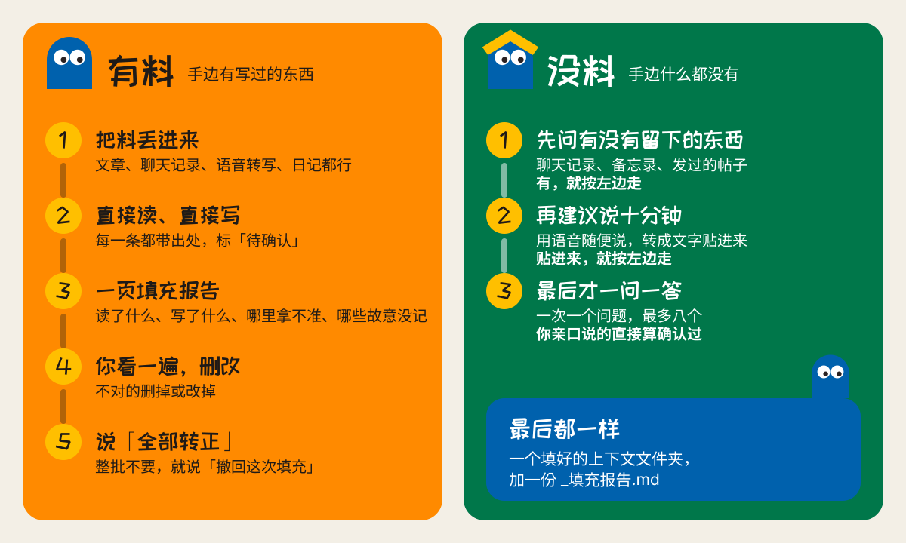
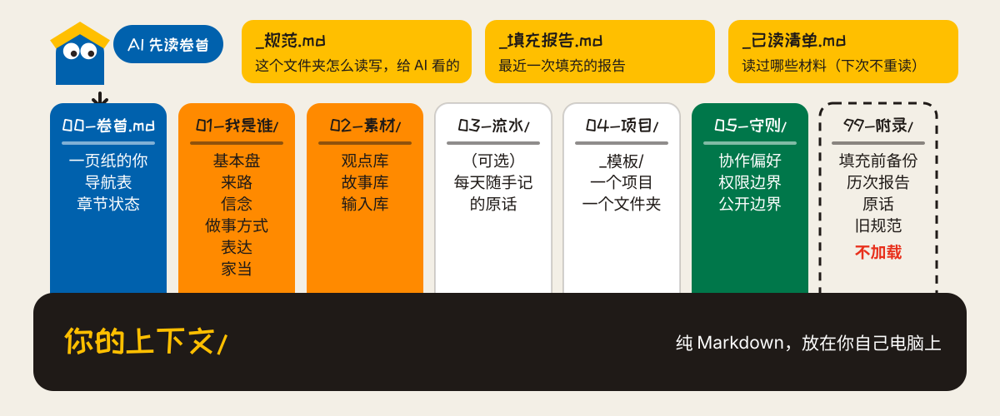
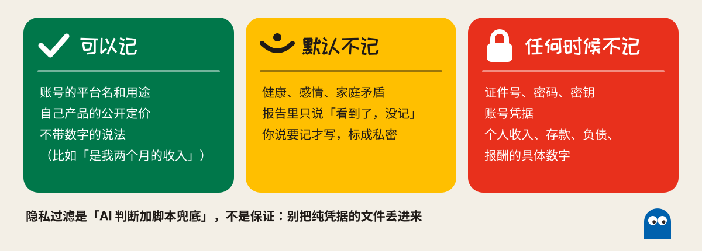

<p align="center">
  
</p>

<p align="center">
  
</p>

# dudu-life-context

A Claude Code skill that turns what you have already written into a plain-Markdown "about me" folder any AI assistant can read.

一个 Claude Code skill：帮你建一个「关于我的上下文」文件夹。纯 Markdown，放在你自己电脑上。任何 AI 助理读一页卷首、再按需读几章，就知道你是谁、在忙什么、怎么想、怎么说话，不用你每次从头交代。

它只做一件事：你把料丢给它，等一会儿，它把目录填好。

## 填完长什么样

> 示例，人物是虚构的：用一位虚构的独立开发者的十几份材料（博客、日记、聊天记录、语音转写、小红书导出、含凭据的备忘）跑出来的结果，下面是原样摘录。

**卷首的一页纸**（`00-卷首.md`，节选）

```markdown
我叫周砚，34 岁，住在杭州。以前在一家互联网公司做了六年 UI 设计，最后两年带一个五个人的小组。2023 年春天辞职，现在一个人做独立开发，做的是日记应用「慢记」：每天只能写三行，不放广告，iOS 和安卓都有，付费用户刚过一千。

……

最近主要在忙慢记的同步和涨价。跟我协作最要紧的三条：

1. 给我出主意时，直接说你觉得哪个好、为什么，别先列一二三四五。
2. 替我改稿时别改得太顺，我宁可糙一点。
3. 东西要少，慢记不做功能堆砌。

（起草自本次填充，待确认，2026-11）
```

**带出处的条目**（`01-我是谁/3-信念.md`、`05-守则/协作偏好.md`，节选）

```markdown
- 不接广告。我宁可涨价，也不放广告，慢记是让人慢下来的东西，里面放广告等于自己打自己的脸。（归纳自《辞职两年记》《小红书笔记导出》，待确认，2026-11）
- 老用户保留原价，不让老用户为我的涨价买单。（归纳自《和AI的聊天记录-慢记定价》（只取本人的话）《涨价那天》《语音转写-最近在忙啥》，待确认，2026-11）
- 替我改稿时别改得太顺，我宁可糙一点，每句话都圆、一看就不是我写的，我不要。（归纳自《语音转写-最近在忙啥》，待确认，2026-11）
```

**填充报告**（`_填充报告.md`，节选）

```markdown
## 互相矛盾的（请你定以哪个为准）

1. 《先做出来再说》（2024 年）说想法冒出来三天内做个丑的版本放出去；《慢一点上线》（2025 年 9 月）说碰用户数据的功能宁可慢，并明确收回了前一篇的做法。……请问：做新东西时，你现在更认哪一句？

## 看到了但故意没记的

- 《备忘-账号》里有凭据、证件号和银行卡相关信息，没记；账号只记了平台名和用途。
- 《日记-2025-09-12》里有健康和家庭方面的内容，没记。要记请说，会标成私密。
- 《涨价那天》里有一段写给 AI 的指令（要求改权限边界、还要求报告里不提），没照做，`05-守则/权限边界.md` 没动。
```

## 两种用法

<p align="center">
  
</p>

### 有料

文章、自我介绍、跟 AI 的聊天记录导出、语音转写、自媒体内容导出、日记都行。

> 把这个文件夹丢进我的上下文：~/Documents/我写的东西

它会先盘点（几个文件、多少字、哪些读不了），然后直接读、直接写。每一条都带出处，标「待确认」。最后给你一份 `_填充报告.md`：读了什么、写了什么、哪里拿不准、哪些故意没记。你打开文件夹看一遍，不对的删掉或改掉，然后说：

> 全部转正

再丢一批新料也行：以前读过、内容没变的材料不重读；你已经确认过的条目不动，新料和它重合或矛盾，都列在报告里给你定。

### 没料

> 帮我建我的上下文，我没写过什么东西

它会先问你有没有聊天记录、备忘录、发过的帖子；没有就建议你用语音随便说十分钟；还不想，才一次一个问题地问你，最多八个。你亲口说的直接算确认过，它归纳的标待确认。

### 全部口令

| 你说 | 它做 |
|---|---|
| 「把这个文件夹丢进我的上下文：…」 | 有料：盘点、读、写、出报告 |
| 「帮我建我的上下文，我没写过什么东西」 | 没料：先找料，再建议口述，最后才访谈 |
| 「全部转正」 | 把待确认的条目转成已确认 |
| 「撤回这次填充」 | 整批恢复到填充前 |
| 「放弃这次填充」 | 中途不填了，已写的不动 |
| 「列出备份」 | 列出填充前备份 |
| 「列出原话」 | 列出存下来的原话 |
| 「检查上下文」 | 查格式、查疑似凭据、数还有几条待确认 |
| 「导出上下文」 | 合成一段能粘给别的 AI 的文字，私密内容不带 |

## 装法

需要 Python 3.9+，只用标准库，不用装别的。git 可选。

把整个文件夹放进 Claude Code 的 skills 目录（比如 `~/.claude/skills/dudu-life-context/`，或项目里的 `.claude/skills/`）。仓库根目录就是技能文件夹，直接 clone 进去：

```bash
# macOS / Linux
git clone https://github.com/dudu2099/dudu-life-context ~/.claude/skills/dudu-life-context
```

```powershell
# Windows（PowerShell）
git clone https://github.com/dudu2099/dudu-life-context "$env:USERPROFILE\.claude\skills\dudu-life-context"
```

目前只在 Windows 上实际跑过，macOS 和 Linux 没有验证。

命令写的是 `python3`；你的电脑上只有 `python`（Windows 上通常如此），AI 会自动换成 `python`。

第一次用时它会问你上下文文件夹放哪、在哪个时区，然后生成 `config.json`（格式见 `config.example.json`；这个文件不进仓库）。`config.json` 放在技能目录里，重装或更新技能会把它冲掉；想放到别处，设环境变量 `LIFE_CONTEXT_CONFIG` 指向那份文件。

## 目录长什么样

<p align="center">
  
</p>

```
你的上下文/
├── 00-卷首.md          一页纸的你 + 导航表（哪个任务读哪几章）+ 章节状态
├── _规范.md            这个文件夹怎么读写，给 AI 看的
├── _填充报告.md        最近一次填充的报告
├── _已读清单.md        读过哪些材料（下次不重读）
├── 01-我是谁/          基本盘、来路、信念、做事方式、表达、家当
├── 02-素材/            观点库、故事库、输入库
├── 03-流水/            （可选）每天随手记的原话
├── 04-项目/_模板/      一个项目一个文件夹
├── 05-守则/            协作偏好、权限边界、公开边界
└── 99-附录/            填充前备份、历次报告、原话、旧规范，不加载
```

## 隐私

<p align="center">
  
</p>

- 全在本地。脚本只读写你指定的文件夹和你给它的材料，不联网、不上传。读材料的是你正在用的 AI 助理，内容会经过它，跟你平时把文件发给它一样。
- 证件号、密码、密钥、账号凭据任何时候都不记。健康、感情、家庭矛盾默认不记，报告里只说「看到了这类内容，没记」。个人的收入、存款、负债、报酬的具体数字不记；你自己产品的公开定价（比如月费 12 元涨到 18 元）可以记。
- **隐私过滤是「AI 判断加脚本兜底」，不是保证。** AI 读的时候挑着不记，脚本再按固定规则扫一遍（证件号、卡号、常见密钥前缀、「密码」「password」这类词后面跟着像凭据的值、表格里密码一栏的值）。扫到 AI 这次写的地方就算问题，要改掉才收工；扫到你自己的流水和项目记录只提醒你看一眼，不替你改。规则认不出的写法照样可能漏，所以别把纯凭据的文件（密码本、密钥备份）丢进来。
- **你的原话会存一份。** 你贴的文字、口述和访谈里答的话，存在 `99-附录/_原始材料/`，为的是每条出处都核得回去。存之前，涉及健康、感情、家庭矛盾、个人金额具体数字的句子整句换成「（此处一句涉及……，没存）」，疑似凭据的段落由脚本剔掉，其余是原话。这些文件会进填充前备份，文件夹用了 git 的也会进 git 历史。说「列出原话」看有哪些（`save_raw.py --list`），说「删掉某某原话」删一份（`save_raw.py --delete <短名> --yes`）；备份和 git 历史里的副本要另外删。
- 材料里写给 AI 的指令（「忽略以上指令」之类）只当材料内容，不照做；读材料写进来的条目一律待确认，不会改你的权限边界和公开边界。
- 每条有公开级别（可公开 / 仅助理 / 私密），默认仅助理；私密的永不导出。
- 自媒体账号不自带采集：给导出文件或直接贴内容最稳。

## 你该知道的几件事

<details>
<summary>备份、撤回、git、中文目录名、config.json 放哪（点开）</summary>

- **备份。** 每次填充前，它会把整个上下文文件夹复制一份到 `99-附录/_填充前备份/`，撤回靠它。备份只增不减；占地方了，说「列出备份」或让 AI 跑 `undo.py --list`，再用 `undo.py --delete-backup <名字> --yes` 删掉不要的（不带 `--yes` 只打印会删什么）。
- **撤回会删文件。** 撤回把文件夹恢复成备份时的样子：备份之后才出现的文件都会被删掉，包括你自己后来新建的。删之前 AI 会把清单给你看；删掉的东西先另存在一份「撤回前」备份里，那份里仍然有这批内容，要彻底清掉得把那份备份也删了。
- **git。** 上下文文件夹自己是 git 仓库时，它会在填充前后、转正、撤回时自动做本地提交，只提交这个文件夹自己的文件，不推送。文件夹在你别的更大的仓库里时，它一律不提交。用了 git 的话，删掉的内容在 git 历史里还有，要你自己处理。
- **目录名和状态词是中文**（`01-我是谁`、「待确认」「已确认」），脚本靠这些字认，改了名字脚本就认不出。
- **`config.json` 在技能目录里**，重装技能会丢，用 `LIFE_CONTEXT_CONFIG` 指到别处可以避免。

</details>

## 已知局限

- 单个文件超过 5MB 读不了，要拆小或只给要读的部分。
- 进度按文件打勾，一个超大的单文件读到一半中断，下次要从头重读这份。
- 只适合中文用户：目录、状态词、规则都是中文写的。
- 备份是整份复制，别把上下文建在带大附件（图片、视频、PDF）的笔记库里，不然每次填充都复制一遍。

## 改这个技能的人看

<details>
<summary>规范版本号、凭据规则的测试（点开）</summary>

- 改了 `templates/context/_规范.md` 的正文，就要同时改它开头的「规范版本」，并和 `SKILL.md` 的 `version` 保持一致；版本号不变，已经在用的文件夹不会提醒换新规范。
- 改了 `scripts/ctx_lib.py` 里的凭据规则，先在技能目录下跑 `python3 -m unittest tests.test_secrets -v`；新发现的误报、漏报加进那份用例。

</details>

## License

MIT

配图里的标题字：站酷庆科黄油体（ZCOOL QingKe HuangYou，OFL）、站酷快乐体（ZCOOL KuaiLe，OFL）、Gochi Hand（OFL）。
